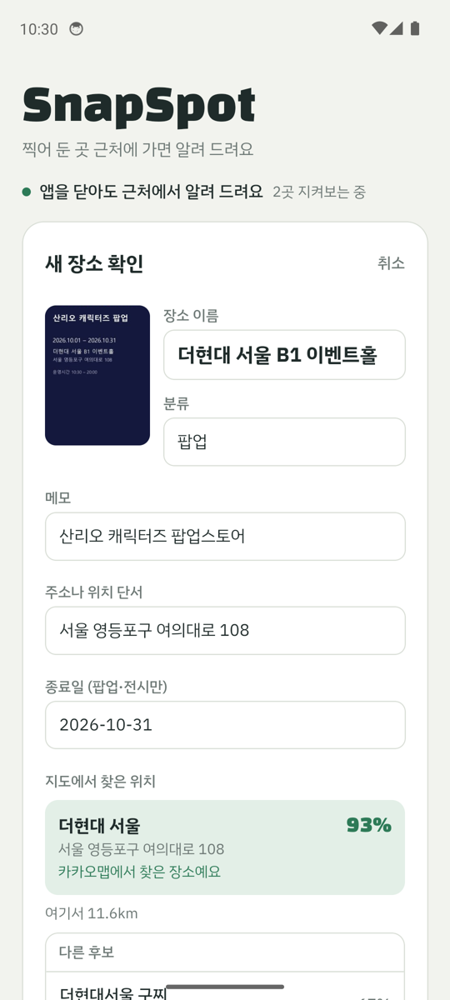
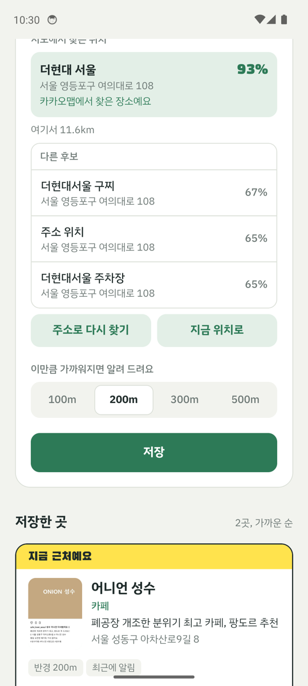

# SnapSpot

찍어 둔 스크린샷 속 장소를, **그 근처를 지나갈 때 알려 주는** 안드로이드 앱 (프로토타입)

인스타그램 맛집, 팝업스토어 포스터, 전시 홍보 같은 스크린샷은 저장만 하고 잊어버리기 쉬워요.
SnapSpot은 스크린샷에서 장소를 뽑아 두었다가, 앱이 꺼져 있어도 그 장소 반경에 들어가면 알림을 보내요.

<p>
  
  
  
</p>

**디자인**: "지도 위 형광펜". 지도 종이색 바탕에 공원 초록을 주요 동작 색으로 쓰고, 형광 노랑은 "지금 근처예요" 한 가지 뜻에만 써요.
카드마다 사용자가 찍은 스크린샷을 그대로 보여 줘서 "내가 저장한 그 게시물"을 바로 알아볼 수 있어요.
글꼴은 Black Han Sans(제목, 거리)와 IBM Plex Sans KR(본문)을 앱에 내장했어요.

## 동작 흐름

```
스크린샷 선택
  → 1024px로 줄여 Gemini(이미지 이해)에 전송
  → 장소 이름 · 주소 단서 · 분류 · 메모 · 종료일(JSON) 추출
  → 카카오 로컬 검색으로 실제 장소 매칭 (이름·주소·분류로 후보마다 신뢰도 점수)
     카카오 결과가 없거나 신뢰도가 낮으면 기기 지오코더로 대체 (실패 시 "현재 위치로" 저장)
  → 기기에 저장 (AsyncStorage)
  → OS 지오펜스 등록 (가까운 장소부터 최대 90곳 / iOS 20곳)
  → 반경 진입 → 백그라운드 작업이 깨어나 알림
```

**알림 필터**
- 종료일이 지난 팝업·전시는 지오펜스에서 빼요.
- 같은 장소는 6시간에 한 번만 알려요.

**앱이 열려 있을 때**는 위치 감시(watchPosition)로도 같은 판정을 해서, Expo Go에서도 시연할 수 있어요.

## 폴더 구조

```
index.ts            앱 진입점 (백그라운드 작업을 먼저 등록)
App.tsx             화면과 흐름 (추가 · 확인 · 목록)
src/ui/theme.ts     색 · 글꼴 · 간격 토큰
src/ui/components.tsx  버튼, 장소 카드, 매칭 결과, 반경 선택 등 화면 부품
src/gemini.ts       스크린샷 → 장소 정보 추출 (Gemini REST, JSON 스키마 강제)
src/kakao.ts        카카오 로컬 검색 (키워드 + 주소) → 후보 목록
src/match.ts        후보 신뢰도 점수 (이름 유사도 · 주소 일치 · 분류 일치), 단위 테스트 match.test.ts
src/geo.ts          기기 지오코딩(대체 경로), 거리 계산
scripts/eval-match.ts  정답 달린 스크린샷으로 매칭 정확도 측정
src/background.ts   지오펜스 작업, 가까운 N곳 교체 로직
src/notify.ts       알림 채널, 필터(종료일 · 쿨다운), 발송
src/storage.ts      장소 저장소
```

## 실행 방법

### 0. 준비
- Node.js 20 이상
- 안드로이드 폰
- Gemini API 키
- 카카오 REST API 키 (developers.kakao.com → 앱 만들기 → 앱 키의 REST API 키. **제품 설정 > 카카오맵 활성화** 필요)

```bash
npm install
cp .env.example .env      # Windows: copy .env.example .env
# .env 안에 EXPO_PUBLIC_GEMINI_API_KEY, EXPO_PUBLIC_KAKAO_REST_KEY 입력
npm test                  # 매칭 점수 단위 테스트
```

**매칭 정확도 측정** (신뢰도 측정 계획의 첫 번째 지표):
```bash
node --env-file=.env scripts/eval-match.ts eval/labels.json
```
`eval/labels.json`에 스크린샷 파일명과 정답(장소명·위도·경도)을 추가하면 돼요. 카카오 매칭과 "주소만" 기준선의 100m 이내 비율, 중앙 오차를 비교해 보여 줘요.

### 1. 빠른 확인 (Expo Go, 앱 안 알림만)
폰에 Expo Go를 설치하고 실행해요.
```bash
npx expo start
```
QR을 찍으면 앱이 열려요. 스크린샷 추가와 앱이 열려 있을 때의 근처 알림까지 확인할 수 있어요.
Expo Go에서는 백그라운드 작업이 막혀 있어서 **앱이 꺼져 있을 때 알림은 2번 APK에서만** 동작해요.

### 2. 설치용 APK (앱 밖 알림까지)
무료 Expo 계정이 필요해요. 빌드는 Expo 클라우드에서 돌아서 Android Studio는 필요 없어요.
```bash
npx eas-cli@latest login
npx eas-cli@latest init                       # 프로젝트 연결 (처음 한 번)
npx eas-cli@latest env:create --environment preview --name EXPO_PUBLIC_GEMINI_API_KEY --value "키" --visibility sensitive
npx eas-cli@latest env:create --environment preview --name EXPO_PUBLIC_GEMINI_MODEL --value "gemini-3.5-flash-lite" --visibility plaintext
npm run build:apk
```
`.env`는 빌드 서버로 올라가지 않아요. 그래서 키를 `env:create`로 따로 등록해야 해요.
빌드가 끝나면 나오는 링크나 QR로 폰에 APK를 받아 설치하면 돼요.

설치 후 첫 실행:
1. "권한 설정하기" → 위치 **항상 허용**, 알림 허용
2. 배터리 최적화에서 SnapSpot을 "제한 없음"으로 바꾸기 (제조사에 따라 백그라운드가 막힐 수 있어요)
3. 설정 > 위치 > 위치 서비스 > "Google 위치 정확도"가 켜져 있어야 해요. 꺼져 있으면 OS가 지오펜스를 모두 지워서 앱 밖 알림이 오지 않아요. (앱이 감지해서 "위치 정확도 켜기" 버튼을 보여 줘요)

## 시연 시나리오
1. 근처 카페 인스타 게시물 스크린샷을 추가 → 이름·주소·메모가 자동으로 채워지는 걸 보여 주기
2. 반경 200m로 저장 → 목록에 거리 표시
3. 앱을 완전히 종료 → 그 카페 쪽으로 걸어가기 → 잠금 화면에 "저장해 둔 카페 근처예요" 알림
   - OS 지오펜스는 반경 진입 후 알림까지 몇 분 걸릴 수 있어요 (에뮬레이터 측정 약 3분 30초). 여유 있게 잡으세요.
4. 실내 시연용: 장소 카드의 "알림 테스트" 버튼

## 신뢰도 측정 계획
| 지표 | 방법 |
|---|---|
| 장소 추출 정확도 | 스크린샷 100장에 정답(장소명·주소)을 달고 이름 일치율, 좌표 오차(m) 측정 |
| 도착 알림 성공률 | 실제로 반경에 진입한 횟수 대비 알림 수신 비율 |
| 알림 지연 | 반경 진입 시각 → 알림 수신 시각 |
| 오알림 차단 | 종료된 팝업, 중복 알림이 걸러진 비율 |

## 한계와 다음 단계
- 프로토타입이라 Gemini 키가 앱에 들어 있어요. 실제 서비스는 서버(Spring Boot)를 거치게 바꿔야 해요.
- 안드로이드 기기 지오코더를 써서 상호명만 있으면 위치를 못 찾을 수 있어요 → 카카오 로컬 API로 교체 예정
- 공유 버튼으로 바로 보내기(공유 시트), 인스타·지도 링크 수집
- 영업시간 반영, 저장한 곳과 "비슷한 장소" 추천
- 서버 동기화와 로그인, 친구와 장소 공유
