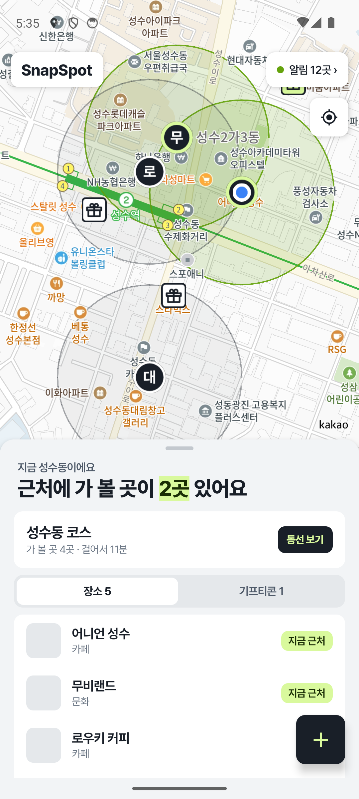
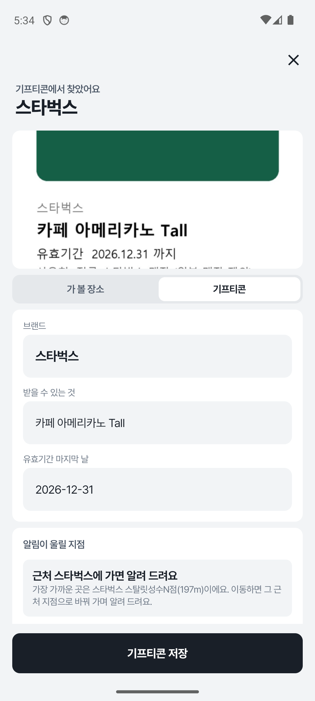
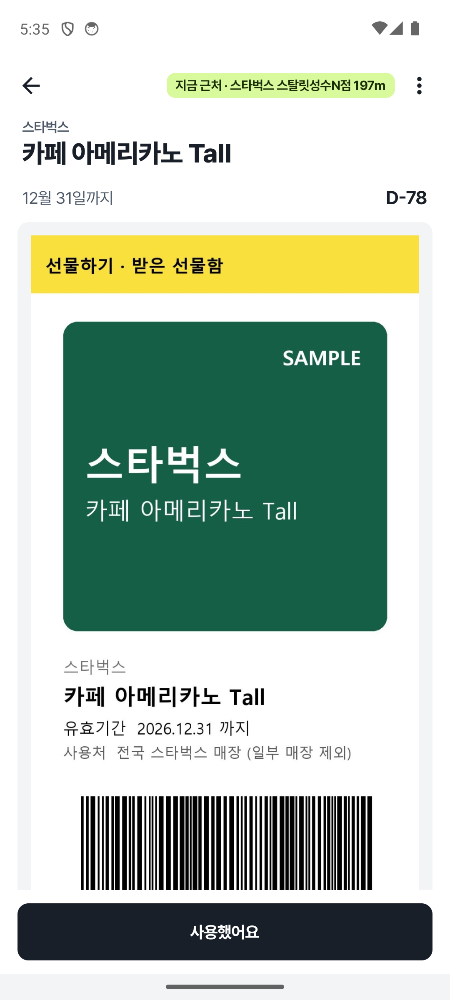
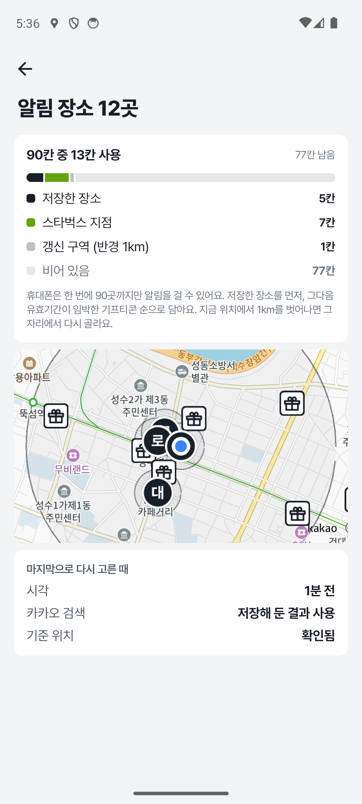
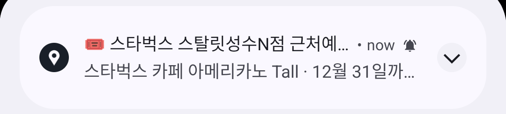
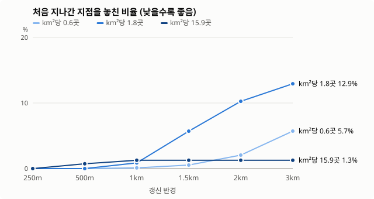
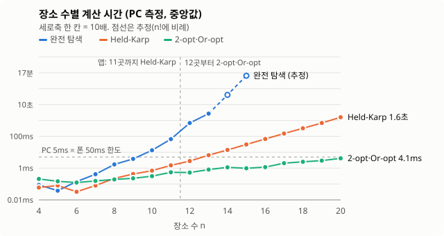
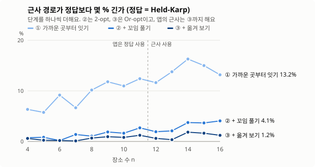
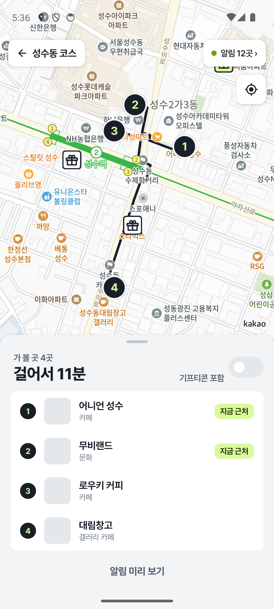
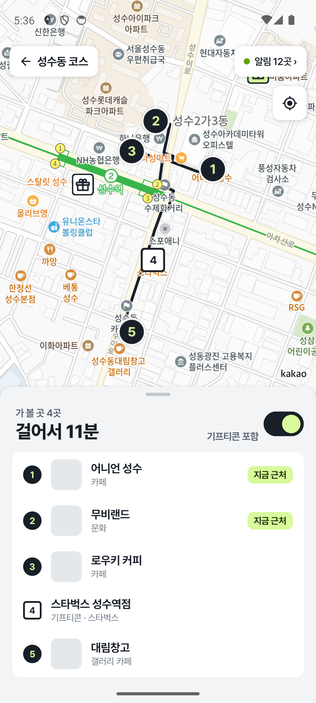

# SnapSpot

중요한 장소를 스크린샷으로 찍어 두면, **그 근처를 지나갈 때 알려 주는** 안드로이드 앱 (캡스톤 프로토타입, Kotlin)

스크린샷을 한 장 넣으면 두 가지로 나뉘어요.

- **가 볼 장소** (인스타 맛집, 팝업 포스터): 그 장소를 지도에서 찾아 두었다가, 반경에 들어가면 알려 줘요. 앱의 중심 기능이에요.
- **기프티콘** (프랜차이즈 모바일 교환권): 그 브랜드의 가까운 지점에 다가가면 알려 주고, 알림을 누르면 바로 쓸 수 있게 기프티콘을 띄워요.

두 경우 모두 **앱이 꺼져 있어도** 동작해요.

<p>
  
  
  
  
</p>
<p>
  
</p>

## 핵심 문제: 휴대폰은 90곳까지만 알림을 걸 수 있어요

앱이 꺼져 있어도 알림을 받으려면 OS 지오펜스를 써야 해요. 그런데 Android는 한 앱이 등록할 수 있는 지오펜스가 **100곳**으로 정해져 있어요.
스타벅스 기프티콘 한 장이면 성수동 반경 2.5km 안에만 지점이 27~33곳이에요. 서울 전체로는 수백 곳이라 다 등록할 수 없어요.

**내 위치를 따라 움직이는 알림 구역** (`core/Window.kt`)으로 풀었어요.

```
내 위치 기준으로
  ├─ 우선순위대로 칸 채우기
  │    1. 저장한 장소 (전부)
  │    2. 3일 안에 끝나는 기프티콘의 브랜드 지점
  │    3. 나머지 기프티콘의 브랜드 지점
  │    기프티콘 브랜드는 가까운 7곳까지만, 같은 등급 브랜드끼리 돌아가며 한 곳씩
  ├─ 지점 반경 200m 지오펜스 × 최대 89개
  └─ 내 위치를 둘러싼 반경 1km "갱신 구역" 지오펜스 1개 (나갈 때만 알림)

갱신 구역을 벗어나면 → OS가 꺼져 있던 앱을 백그라운드에서 실행 → 그 자리에서 카카오로 지점 재검색 → 다시 고르기
```

위치를 계속 추적하지 않아요. 사용자가 1km를 벗어날 때만 앱이 백그라운드에서 잠깐 실행돼서 배터리를 거의 쓰지 않아요.
카카오 검색 결과는 약 1km 격자 칸 단위로 6시간 동안 저장해 두고 다시 써요.

기프티콘은 "어느 지점이든 한 번 알려 주면 되는" 성격이라 브랜드마다 가까운 7곳이면 충분해요. 그래서 남는 칸을 저장한 장소와 다른 브랜드에 돌릴 수 있고, 지도도 깔끔해져요.

### 갱신 반경은 왜 1km인가

갱신 반경이 작으면 등록된 지점이 늘 지금 위치 근처라 놓치지 않지만 자주 갱신해요. 크면 갱신은 드물지만, 멀어진 뒤에는 "아까 자리 근처" 지점만 등록돼 있어서 지금 지나가는 지점을 놓쳐요.

지점 50곳을 원 안에 고르게 뿌리고(위도·경도만), 가상 사용자 1,500명이 그 안을 걷게 해서 반경별로 비교했어요. 원 크기를 바꿔 밀도를 서울 번화가(km²당 15.9곳), 메가커피 서울 평균(1.8곳), 올리브영 서울 평균(0.6곳) 세 가지로 봤어요. 자세한 설정과 전체 표는 [docs/refresh-radius.md](docs/refresh-radius.md)에 있어요.

<p></p>

| 갱신 반경 (서울 평균 밀도, 갱신 지연 2분) | 처음 지나간 지점에서 알림 | km당 갱신 횟수 |
|---|---|---|
| 500m | 100.0% | 1.36 |
| **1km** (지금 설정) | **99.1%** | **0.68** |
| 1.5km | 94.3% | 0.44 |
| 2km | 89.7% | 0.35 |

- **1km까지는 알림을 거의 잃지 않아요.** 그러면서 갱신은 500m의 절반이에요.
- **1km를 넘으면 처음 지나간 지점을 놓치는 경우가 빠르게 늘어요.** 2km면 열 번에 한 번꼴이에요.
- 번화가(98.7%)와 지점이 드문 곳(99.9%)에서도 1km는 알림을 잃지 않아요. 앱은 사용자 주변 밀도를 미리 알 수 없어서, **어느 밀도에서도 안전한 가장 큰 값**으로 1km를 골랐어요.

#### 실제 서울 데이터로 확인

위 실험은 지점을 고르게 뿌리고 걷기만 봤어요. 같은 계획 코드(`planRegions`)를 **실제 서울 데이터**와 버스 이동으로도 돌려서, 1km 설정이 실제 환경에서도 알림을 잃지 않는지 확인했어요. 가정과 전체 표는 [docs/refresh-radius.md](docs/refresh-radius.md#실제-서울-데이터로-확인)에 있어요.
- **장소와 지점**: 카카오 로컬 API에서 받은 8개 동네(성수, 연남·홍대, 을지로 등)의 카페·음식점·전시장 160곳, 그리고 스타벅스 755곳, 메가커피 1,282곳, 올리브영 434곳이에요.
- **이동**: 가상 사용자 40명이 동네 사이는 버스로, 동네 안은 걸어서 다녀요. 1인당 5번씩, 시드 3개로 반복해서 모두 600번, 약 13,800km를 다녔어요.

| 전략 (저장한 장소 30곳) | 저장한 장소 | 기프티콘 알림 (지점을 지난 외출 중) | km당 갱신 횟수 |
|---|---|---|---|
| 고정: 출발할 때 가까운 90곳만 등록 | 100.0% | 56.2% | 0.04 |
| **움직이는 창: 90칸, 갱신 1km, 브랜드당 7곳** (지금 설정) | **100.0%** | **100.0%** | 0.56 |
| 움직이는 창: 90칸, 갱신 1km, 갱신이 5분 늦을 때 | 100.0% | 99.9% | 0.36 |

- **저장한 장소**는 모든 설정에서 놓친 방문이 없어요. 장소가 우선순위 1순위라 가까운 순으로 먼저 칸을 차지해요.
- **iOS 한도(20칸)**에서는 저장한 장소가 30곳을 넘으면 장소가 칸을 다 차지해서 기프티콘 알림이 0%가 돼요(10곳일 때는 99.7%). iOS로 넓힐 때는 기프티콘 몫 칸을 남겨 둬야 해요.
- 지금 설정에서 울리는 알림의 약 63%는 버스로 지나가며 울리는 알림이에요. 이 알림은 미뤘다가 근처에서 내려 걸을 때만 울려요.

### 실제 동작 확인 (에뮬레이터, 2026-10-13)

1. 압구정(가장 가까운 스타벅스까지 361m)에서 스타벅스 기프티콘을 저장해요. 가까운 7곳이 등록되고, 알림은 오지 않아요.
2. 앱을 완전히 종료하고, 모의 위치를 40초마다 약 210m씩 옮겨 성수역까지 약 3km 이동해요.
3. 출발 후 약 1km 지점에서 갱신 구역을 벗어나자 OS가 꺼져 있던 앱을 백그라운드에서 실행했고, 그 자리에서 지점을 다시 골랐어요(갱신).
4. 성수역에 도착하고 약 50초 뒤 "🎟️ 스타벅스 성수점 근처예요" 알림이 왔어요. 출발할 때는 등록돼 있지 않던 지점이에요. 알림을 누르면 기프티콘 화면이 바로 열려요.

에뮬레이터에서 직접 해 볼 때는 Google 지도 같은 다른 앱을 켜 두세요. 에뮬레이터에는 와이파이·기지국 위치가 없어서, GPS를 요청하는 앱이 없으면 `adb emu geo fix`로 옮긴 위치가 지오펜스에 전달되지 않아요. 실제 폰에서는 필요 없어요.

## 이동수단: 버스·택시로 지나갈 때는 알림을 미뤄요

버스를 타고 저장한 장소 앞을 지나가면 "근처예요" 알림이 와도 내릴 수가 없어요. 실제 서울 데이터 시뮬레이션에서는 지금 설정에서 울리는 알림의 **약 63%가 버스로 지나가며 울리는 알림**이었어요([docs/refresh-radius.md](docs/refresh-radius.md#실제-서울-데이터로-확인)).
그래서 차량으로 지나갈 때는 알림을 미뤄 두었다가, **그 근처에서 내려 걸을 때** 알려요.

```
반경 진입 (OS 지오펜스)
  ├─ 진입 순간 속도 < 시속 15km, 또는 속도를 모름  → 바로 알림
  └─ 진입 순간 속도 ≥ 시속 15km (차량)              → 보류
        3분마다 GPS로 위치·속도 확인
          ├─ 그 장소에서 1km 안 + 걷는 중  → 알림
          ├─ 아직 차량                       → 3분 뒤 다시 확인
          └─ 1km 밖으로 멀어짐, 또는 30분 지남 → 보류만 버림 (지오펜스는 그대로)
```

- **1km 기준은 장소에서 내 위치까지의 거리예요.** 1km 안에서 내렸다면 걸어서 갈 만하니 알리고, 이미 멀리 지나쳤다면 쓸모없는 알림이라 보내지 않아요. 위의 갱신 구역 1km(내 위치 기준)와는 다른 값이에요.
- **보류를 버려도 그 장소를 잃지 않아요.** 지오펜스는 남아 있어서, 나중에 걸어서 반경에 들어가면 평소처럼 알려요.
- **속도를 모르면 걷는 것으로 봐요.** 와이파이·기지국으로 잡힌 위치에는 속도가 없어요. 알림을 놓치는 것보다 한 번 더 받는 쪽이 낫다고 봤어요.
- 같은 브랜드 지점을 연달아 지나가면 보류는 하나로 합쳐요. 앱이 화면에 떠 있으면 시스템 알림 대신 목록의 "지금 근처예요"로만 보여 줘요.
- 코드: 판단 규칙 `core/Pending.kt`, 진입 속도 `geofence/GeofenceReceiver.kt`, 3분 재확인 `geofence/RecheckWorker.kt`, 보류 저장 `data/PendingStore.kt`

### 확인한 것

- **단위 테스트**: 판단 규칙 9개(속도 기준, 1km·30분 경계, 같은 브랜드 합치기 등), 보류 저장소 2개, 화면이 떠 있을 때 조용한지 1개
- **에뮬레이터** (Android 14, 모의 위치)

| 상황 | 결과 |
|---|---|
| 약 6m/s(시속 22km)로 장소를 지나감 | 알림 없이 보류 |
| 485m 지나서 내려 걸음 | 약 3분 뒤 알림 |
| 1.2km 지나서 걸음 | 보류만 버리고 알림 없음 |
| 앱이 화면에 떠 있을 때 진입 | 시스템 알림 없음 |

### 한계 (실기기 검증은 중간발표 이후 예정)

에뮬레이터의 모의 GPS에는 속도가 늘 들어 있어서 실제보다 유리해요. 실제 폰에서는 아래 경우에 미루지 못하고 **예전처럼 바로 알릴** 수 있어요. 틀려도 알림을 잃는 쪽이 아니라 한 번 더 받는 쪽이에요.
- 앱이 꺼져 있을 때 지오펜스가 와이파이·기지국 위치로 울리면 속도가 없어요.
- 속도는 진입 순간 한 번만 봐요. 정류장이나 신호에 선 버스, 시속 15km 아래로 막히는 구간은 걷는 것으로 판단해요.
- 지하철은 GPS가 잡히지 않아요.
- 그래서 위 63%는 "속도가 늘 있다"는 가정에서 미룰 수 있는 최대치예요. 실제로 미뤄지는 비율은 이보다 낮을 거예요. 결과가 나쁘면 Google Activity Recognition(차량 안 판별)을 쓰는 방법이 있어요.

## 최단 경로 (동네 묶음)

동네 묶음의 걷기 동선은 출발점이 있고 돌아오지 않는 외판원 문제예요. 기프티콘 지점을 넣으면 브랜드마다 여러 지점 중 한 곳만 고르는 **일반화 외판원 문제(Generalized TSP)**가 돼요. 자세한 내용은 [docs/route.md](docs/route.md)에 있어요.

### 순서는 직선 거리로, 지도에는 실제 걷는 길로
- **들르는 순서**는 장소 사이 직선 거리로 앱 안에서 계산해요. 인터넷 없이 바로 나오고, 동네 안 짧은 거리에서는 직선으로 정한 순서와 걷는 길로 정한 순서가 거의 같아요.
- **순서가 정해지면** TMAP 보행자 경로 API에 그 순서대로 물어서, 지도에 실제로 걷는 길을 그리고 카드의 "걸어서 약 N분"도 TMAP이 준 시간으로 바꿔요.
- 한 번에 출발·도착과 경유지 5곳까지만 넣을 수 있어서, 들를 곳이 많으면 7곳씩 끊어서 여러 번 물어요(끊는 곳은 앞 구간의 도착이 다음 구간의 출발).
- 묶음을 펼칠 때만 묻고, 같은 순서는 다시 묻지 않아요. 내 위치는 약 100m 단위로 맞춰서 동네 안에서 걸을 때마다 다시 묻지 않게 했어요.
- TMAP 답이 오기 전이나 실패하면 지금처럼 직선으로 잇고, 시간은 직선 거리 × 1.3 ÷ 분당 70m로 추정해요.
- 순서까지 걷는 길 기준으로 정하려면 장소마다 서로의 거리를 모두 물어야 해요(11곳이면 110번). 느리고 무료 한도(하루 경로 1천 번)도 금방 차서 하지 않았어요.

### 프랜차이즈 지점은 어떻게 고르나요

"기프티콘 포함"을 켜면 들를 곳이 두 종류가 돼요.
- **저장한 장소**: 후보가 1곳뿐인 들를 곳이에요.
- **기프티콘 브랜드**: 후보가 여러 곳인 들를 곳이에요. 묶음 장소에서 500m 안에 있는 지점 중 최대 8곳이 후보예요.

들를 곳마다 후보 하나만 골라서, 전체 동선이 가장 짧아지는 순서와 지점을 함께 구해요(`HomeViewModel.kt`에서 문제를 만들고 `core/Route.kt`가 풀어요).

| 방법 | 어떻게 푸나요 | 복잡도 | 앱에서 쓰는 곳 |
|---|---|---|---|
| **Held-Karp 동적 계획법** (`exactRoute`) | 상태를 "들른 곳의 집합(비트마스크) + 마지막으로 들른 후보 지점"으로 두고 작은 집합부터 채워요. 비트마스크가 지점이 아니라 들를 곳 단위라서, 한 브랜드에서 지점이 하나 정해지면 그 브랜드의 다른 지점은 다시 고르지 않아요 | O(2^g·N²) (g = 들를 곳 수, N = 후보 수) | 11곳 이하, 정확한 최단 경로 |
| **2-opt·Or-opt 휴리스틱** (`heuristicRoute`) | 최근접 이웃(가까운 곳부터 잇기)으로 시작하고, 들를 순서는 2-opt와 Or-opt로 다듬어요. 각 브랜드에서 어느 지점을 고를지는 층 그래프 최단 경로(`repickOptions`, 동적 계획법)로 한 번에 다시 골라요. 둘 다 더 줄지 않을 때까지 번갈아 해요 | 한 바퀴 O(g³ + Σkᵢkᵢ₊₁) | 12곳 이상 |
| **오차 상한** (`lowerBound`) | 두 들를 곳 사이 거리를 "후보끼리의 최소 거리"로 둔 최소 신장 트리. 어떤 동선도 이보다 짧을 수 없어요 | O(g²·k²) | 휴리스틱이 최적에서 얼마나 먼지 계산 |
| 완전 탐색 (`bruteForceRoute`) | 모든 순서 × 모든 지점 선택 | O(g!·∏kᵢ) | 테스트와 실험에서 정답 확인용 |

쉽게 말하면 이래요. 예시와 함께 [docs/route.md](docs/route.md#각-방법을-쉽게-말하면)에 더 자세히 적었어요.
- **완전 탐색**: 가능한 순서를 전부 재 봐요. 확실하지만 한 곳 늘 때마다 대략 n배 느려져서, 정답 확인용으로만 써요.
- **Held-Karp**: "A, B, C를 들렀고 지금 C에 있다"처럼 상황이 같은 경로는 짧은 것 하나만 기억해요. 정확하지만 2ⁿ으로 늘어서 11곳까지만 써요.
- **2-opt·Or-opt 휴리스틱**: 가까운 곳부터 이은 뒤(최근접 이웃), X자로 엇갈린 선을 풀고(2-opt), 1~3곳을 다른 자리로 옮겨 보고(Or-opt), 브랜드 지점을 다시 골라요. 더 줄지 않을 때까지 반복해요.
- **MST 하한**: 모든 장소를 잇는 가장 짧은 선의 합이에요. 어떤 동선도 이보다 짧을 수 없어서, 정답을 모를 때 휴리스틱이 최대 몇 % 긴지 재는 바닥으로 써요.

이렇게 확인했어요.
- **단위 테스트**: `RouteTest`의 `picks the branch that keeps the walk short`는 멀리 있는 지점 대신 동선 옆 지점을 고르는지 봐요. 정확한 풀이가 완전 탐색과 같은 답을 내는지도 무작위 예시 30개로 확인해요.
- **에뮬레이터**: 스위치를 켜자 내 옆 스타벅스가 아니라 3번과 5번 사이 동선 위의 스타벅스가 4번으로 들어갔어요(아래 오른쪽 화면).

실제 서울 장소로 잰 결과를 보면 이래요.
- 2-opt·Or-opt 휴리스틱은 20곳까지 모두 최적(Held-Karp로 구한 정답)보다 평균 2% 안팎, 가장 나쁜 20곳에서도 4.2% 길어요.
- 기프티콘 지점을 최적화해서 고르면, 가장 가까운 지점을 미리 고르는 방법보다 동선이 평균 1.2%(브랜드 1개), 3.9%(브랜드 2개), 최대 12.4% 줄어요.
  묶음 장소들이 이미 700m 안에 몰려 있어서 가장 가까운 지점도 대개 동선 근처라 평균 차이는 작아요. 대신 브랜드가 늘수록 효과가 커지고, 지점이 동선 반대편에 있는 경우에는 크게 줄어요.

<p></p>
<p></p>

### 왜 11곳까지 Held-Karp인가요

위 두 그래프를 같이 보면 돼요.
- **시간**: 9곳부터는 Held-Karp가 2-opt·Or-opt보다 조금 느려요(11곳에서 약 1ms 차이). 하지만 11곳까지는 둘 다 폰 50ms 한도 안이라 사용자는 차이를 느끼지 못해요.
- **동선 길이**: Held-Karp는 정답이라 늘 가장 짧아요(0%). 2-opt·Or-opt는 정답보다 몇 % 길 수 있어요.
- 그래서 기준은 "어느 쪽이 빠른가"가 아니라 **"정답을 한도 안에 낼 수 있는가"**예요. Held-Karp가 한도에 닿는 12~13곳보다 한 칸 여유를 두고 11곳까지 Held-Karp를 쓰고, 12곳부터 2-opt·Or-opt로 바꿔요.
<p>
  
  
</p>

## 브랜드 지점 찾기

카카오 검색에서 "올리브영"을 찾으면 올리브영 매장 사이에 "하파크리스틴 올리브영N성수점"(렌즈 가게), "올리브영N 팝업" 같은 결과가 섞여 나와요.
카카오는 체인점의 `category_name` 끝에 브랜드를 붙여요(`… > 커피전문점 > 스타벅스`). 그래서 `core/Brand.kt`는 이렇게 걸러요.

- 기프티콘의 브랜드 이름과 비슷한 분류명 중에서 실제 매장 이름이 그 분류명으로 시작하는 것을 브랜드로 봐요. "메가커피" 기프티콘도 카카오의 "메가MGC커피" 분류로 찾아가요.
- 그런 분류가 없는 작은 브랜드는 매장 이름이 브랜드로 시작하는지로 판단해요.
- "스타벅스 한남동R 주차장"처럼 이름만 비슷한 시설은 빠져요.

## 장소 매칭

가 볼 장소는 Gemini가 읽은 이름·주소·분류로 카카오 후보마다 신뢰도를 매겨요(`core/Match.kt`). 이름 유사도 60%, 주소 일치 30%, 분류 일치 10%예요.
"더현대 서울 B1 이벤트홀"처럼 긴 이름은 확실한 후보가 나올 때까지 뒤에서부터 한 단어씩 줄여 가며 검색해요(`core/PlaceSearch.kt`).

같은 스크린샷을 두 번 넣어도 같은 곳이 두 번 저장되지 않아요(`core/Dedup.kt`). 카카오 장소 ID가 같거나, 이름이 같고 50m 안에 있으면 이미 저장한 곳으로 봐요.
기프티콘은 브랜드·혜택·유효기간이 같은 기프티콘이 있으면 "그래도 추가"할지 물어봐요. 같은 기프티콘을 실제로 두 장 가질 수도 있어서 막지는 않아요.

## 동작 흐름

```
스크린샷 선택 ("+" 버튼 또는 다른 앱에서 공유, 한 번에 최대 10장)
  → 1024px로 줄여 Gemini에 전송 → 장소인지 기프티콘인지 + 이름·주소·브랜드·혜택·종료일(JSON)
  ├─ 장소: 카카오 매칭(신뢰도 점수) → 실패하면 기기 지오코더 → 저장
  └─ 기프티콘: 근처 지점 미리보기 → 기프티콘 저장
  → 움직이는 알림 구역으로 지오펜스 다시 등록
  → 반경 진입: 꺼져 있던 앱이 백그라운드에서 실행돼 알림 (장소는 6시간, 브랜드는 3시간에 한 번)
     · 차량 속도(시속 15km 이상)로 지나가면 미뤄 두고 3분마다 확인 → 1km 안에서 걸으면 알림, 30분이 지나면 버림
     · 앱이 화면에 떠 있으면 시스템 알림 없이 목록의 "지금 근처예요"로만 보여 줌
  → 기프티콘 알림을 누르면 기프티콘 화면이 바로 열려요 (snapspot:// 딥링크)
```

지오펜스 이벤트는 `GeofenceReceiver`가 받아 WorkManager(`GeofenceWorker`)로 넘겨요. 알림이 동시에 두 번 들어와도 하나만 보내고(`notify/AlertService.kt`), 기기를 재부팅하거나 앱을 업데이트하면 지오펜스를 다시 등록해요(`BootReceiver`).
종료된 팝업과 기간이 지난 기프티콘, 사용한 기프티콘은 알림 대상에서 빠져요.

## 화면

- **홈**: 화면 전체가 지도(카카오맵 SDK)이고, 저장한 장소와 기프티콘 목록은 아래에서 올라오는 바텀 시트에 있어요. 지도에는 알림 반경 원과 선물 아이콘 모양의 지점 핀이 함께 그려져요. 목록은 장소가 먼저, 그다음 끝나 가는 기프티콘, 나머지 기프티콘 순이에요.
- **추가**: 스크린샷 읽기 → 장소 매칭 결과 또는 기프티콘 지점 미리보기 → 확인. 여러 장이면 "2 / 5"처럼 한 장씩 확인하고(저장 또는 건너뛰기), 뒤의 스크린샷은 미리 읽어 둬요. 갤러리나 다른 앱의 공유 메뉴에서 "SnapSpot에 저장"을 골라도 바로 여기로 와요.
- **기프티콘**: 기프티콘 이미지를 크게 띄우고, 가까운 지점과 "사용했어요"를 보여 줘요. 오른쪽 위 ⋮ 메뉴의 "알림 미리 보기"로 알림이 어떻게 보일지 확인할 수 있어요.
- **동네 묶음**: 서로 700m 안에 저장한 장소가 3곳 이상이면 "성수동 · 가 볼 곳 4곳 · 걸어서 약 13분" 카드로 묶어요. 카드를 누르면 모두 들르는 최단 걷기 동선을 지도에 번호로 그려요. "기프티콘 포함"을 켜면 기프티콘 브랜드마다 동선에 가장 잘 맞는 지점 한 곳을 골라 넣어요. 그 동네에 들어가면 장소마다 울리는 대신 "📍 성수동에 가 볼 곳 4곳이 있어요" 알림이 한 번 와요(경로 정보는 홈에서만).
- **현황**: 90칸을 무엇이 얼마나 쓰고 있는지, 마지막으로 다시 고른 때. 위 알고리즘이 지금 어떻게 동작하는지 화면에서 바로 확인할 수 있어요.

잉크(진한 남색에 가까운 검정)와 라임 두 색이 중심인 디자인이에요. 라임은 "지금 근처예요"와 주요 동작 강조에만 써요.
글꼴은 Pretendard(SIL Open Font License 1.1, `docs/licenses/pretendard-OFL.txt`)를 앱에 내장했어요.

## 폴더 구조

```
app/src/main/java/com/capstone/snapspot/
  core/                 안드로이드에 의존하지 않는 순수 로직 (단위 테스트 대상)
    Window.kt             움직이는 창: 우선순위 · 브랜드당 7곳 · 갱신 구역
    Planner.kt            저장한 장소와 기프티콘 → 알림 후보, 칸 수 · 반경 상수
    Brand.kt              카카오 결과에서 진짜 지점만 고르기
    Branches.kt           브랜드 지점 검색 + 격자 칸 캐시
    Coupons.kt            기프티콘 유효기간 · 임박(D-3) · 쿨다운
    Match.kt, PlaceSearch.kt  장소 매칭 신뢰도 · 이름 줄여 가며 검색
    Dedup.kt, Alerts.kt   중복 저장 확인 · 알림 문구
  data/Repository.kt    장소 · 기프티콘 저장 (앱 내부 JSON 파일, 예전 src/storage.ts 자리)
  data/FileBranchCache.kt  지점 검색 캐시
  geofence/             지오펜스 등록(GeofenceSync), 수신(Receiver → Worker), 재부팅 복구
  location/             현재 위치, 기기 지오코더
  net/                  Gemini · 카카오 HTTP 클라이언트 (OkHttp)
  notify/               알림 채널 · 발송 · 쿨다운
  ui/                   Compose 화면 (home, add, coupon, status, map, theme)

app/src/test/           단위 테스트 (JUnit 5) + 시뮬레이터 sim/SimulateWindow.kt, sim/UniformBranches.kt
eval/                   정답 달린 스크린샷 (장소 매칭 정확도 측정용)
docs/refresh-radius.md  갱신 반경을 1km로 고른 근거 (통제 실험 + 실제 서울 데이터로 확인)
```

## 실행 방법

### 0. 준비
- Android Studio (또는 JDK 17 이상 + Android SDK), 안드로이드 폰 또는 에뮬레이터 (Android 8.0 이상)
- Gemini API 키
- 카카오 앱 키 두 개 (developers.kakao.com → 내 애플리케이션 → 앱 키)
  - **REST API 키**: 장소 · 지점 검색
  - **네이티브 앱 키**: 지도 표시

### 1. 카카오 콘솔 설정
1. 앱 → 플랫폼 → Android 플랫폼 등록: 패키지명 `com.capstone.snapspot`
2. 같은 곳에 **키 해시**를 등록해요. 디버그 빌드는 팀원마다 키 해시가 달라서 각자 등록해야 해요.
   ```bash
   keytool -exportcert -alias androiddebugkey -keystore ~/.android/debug.keystore -storepass android | openssl sha1 -binary | openssl base64
   ```
   키 해시가 등록되지 않으면 지도 인증이 401로 실패하고 지도가 빈 화면으로 나와요.
3. 제품 설정 → 카카오맵 → **사용 설정 ON**

### 2. 키 넣기
```bash
cp local.properties.example local.properties   # Windows: copy local.properties.example local.properties
```
`local.properties`에 `GEMINI_API_KEY`, `KAKAO_REST_KEY`, `KAKAO_NATIVE_KEY`, `TMAP_APP_KEY`를 넣어요. TMAP 키는 [TMAP API](https://tmapapi.tmapmobility.com/)에서 앱을 등록하고 받아요(동네 묶음의 걷는 길). 이 파일은 gitignore돼 있어서 커밋되지 않아요.
키가 없어도 빌드는 돼요(빈 문자열). 그때는 스크린샷 읽기와 지도가 동작하지 않고, TMAP 키가 없으면 동선을 직선으로 그려요.

### 3. 빌드하고 설치
Android Studio로 프로젝트를 열고 실행하거나, 명령줄에서:
```bash
./gradlew installDebug        # 연결된 기기 · 에뮬레이터에 설치
```
카카오맵 SDK는 ARM 라이브러리만 들어 있어요. x86_64 에뮬레이터에서는 ARM 변환으로 돌아가서 지도가 조금 느릴 수 있어요.

### 4. 첫 실행
1. 홈의 "권한 설정하기" → 위치 **항상 허용**, 알림 허용
2. 배터리 최적화에서 SnapSpot을 "제한 없음"으로 (제조사에 따라 백그라운드가 막힐 수 있어요)
3. 설정 > 위치 > 위치 서비스 > **"Google 위치 정확도"를 켜 두기**. 꺼져 있으면 OS가 지오펜스를 모두 지워요. 앱이 감지해서 켜기 버튼을 보여 줘요.

## 테스트와 측정

```bash
./gradlew testDebugUnitTest                                   # 단위 테스트 132개 (측정용 3개는 건너뜀)
./gradlew :app:testDebugUnitTest -Psim -PsimWrite             # 갱신 반경 실험 + 실제 서울 데이터 확인 → docs/refresh-radius.md
```

GitHub Actions가 push와 PR마다 단위 테스트와 디버그 빌드를 돌려요(`.github/workflows/android.yml`).

| 지표 | 상태 |
|---|---|
| 지오펜스 전략별 방문 놓침률 | 시뮬레이션 완료 (위 표) |
| 꺼진 앱에서 이동 후 기프티콘 알림 | 에뮬레이터에서 확인 (위 "실제 동작 확인") |
| 장소 진입 → 알림 지연 | 에뮬레이터 3~4분 (Android 지오펜스 특성) |
| 장소 매칭 정확도 | 정답 스크린샷이 2장뿐이라 실제 스크린샷 50~100장이 필요해요 |
| 실제 폰 알림 성공률 · 배터리 | 아직 안 함 |

## 시연 시나리오
1. 갤러리에서 스크린샷 여러 장을 골라 "SnapSpot에 저장"으로 공유 → 한 장씩 확인 → 카카오 매칭 신뢰도 → 홈 지도에 핀과 알림 반경 원
2. 기프티콘 스크린샷 추가 → 브랜드·혜택·유효기간이 채워지고 근처 지점 미리보기
3. "현황"에서 90칸이 장소와 지점으로 나뉘는 걸 보여 주기
4. 앱을 종료하고 지점 쪽으로 걸어가기 → "스타벅스 ○○점 근처예요" 알림 → 누르면 기프티콘이 바로 열림
   - 지오펜스 알림은 반경에 들어간 뒤 몇 분 늦게 올 수 있어요. 실내에서는 기프티콘 화면 ⋮ 메뉴의 "알림 미리 보기"를 쓰세요.

## 한계와 다음 단계
- 프로토타입이라 API 키가 앱에 들어 있어요. 실제 서비스는 서버를 거쳐서 키를 숨기고, 지점 검색 결과를 서버에서 캐시해야 해요.
- 차량 판단은 지오펜스 이벤트 위치의 속도로만 해요. 실기기 검증은 아직이에요(위 "이동수단"의 한계 참고).
- iOS 버전은 범위 밖이에요. iOS는 지오펜스가 20곳뿐이라, 저장한 장소가 많으면 기프티콘 몫 칸을 따로 남겨 두는 규칙이 필요해요(위 "실제 서울 데이터로 확인" 참고).
- 다음: 기프티콘 바코드를 띄울 때 화면 밝기 최대로, 들르는 순서도 걷는 거리 기준으로(지금은 지도에 그리는 선만 실제 걷는 길)
