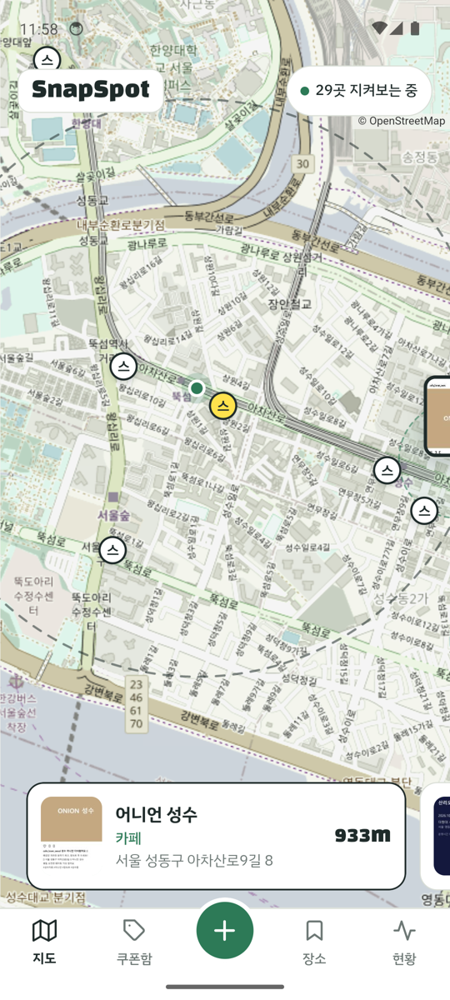
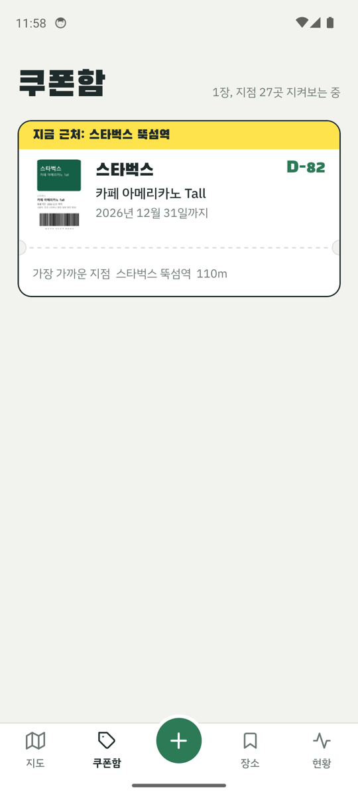
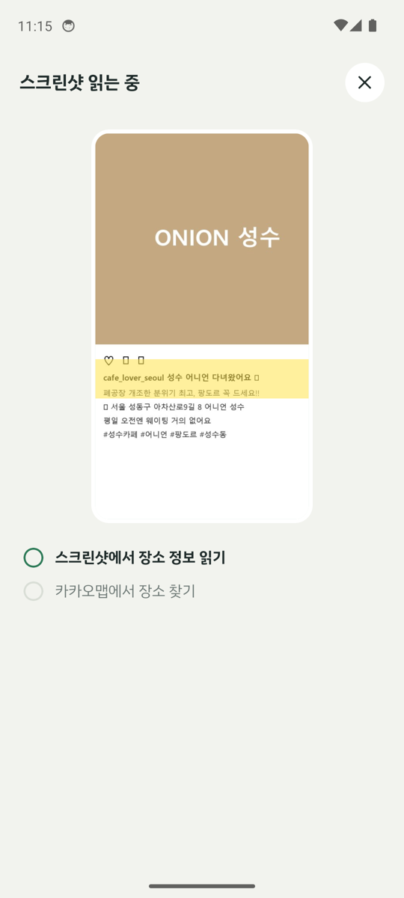
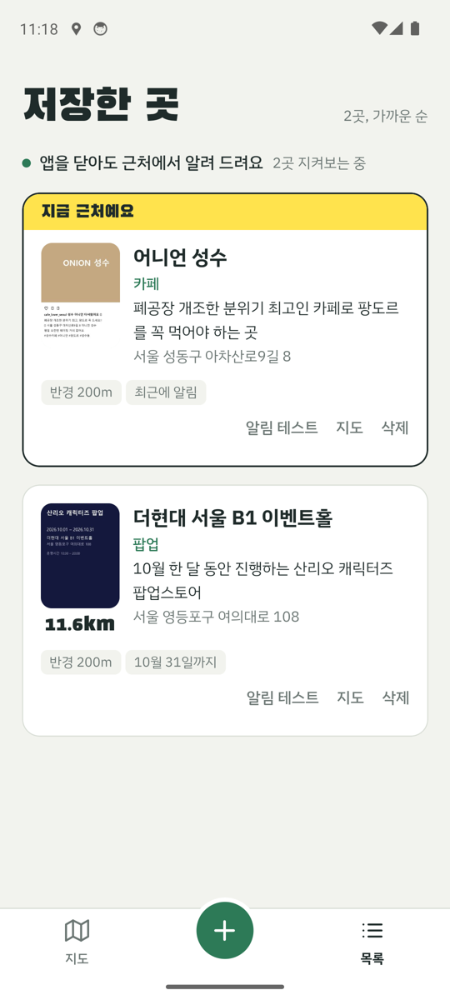

# SnapSpot

찍어 둔 맛집과 쿠폰을, **그 근처를 지나갈 때 알려 주는** 안드로이드 앱 (캡스톤 프로토타입)

스크린샷을 한 장 넣으면 두 가지로 나뉘어요.

- **가 볼 장소** (인스타 맛집, 팝업 포스터): 그 장소를 지도에서 찾아 두었다가, 반경에 들어가면 알려 줘요.
- **프랜차이즈 쿠폰** (기프티콘, 모바일 쿠폰): 그 브랜드의 **어느 지점이든** 가까워지면 알려 주고, 알림을 누르면 바로 쓸 수 있게 쿠폰을 띄워요.

두 경우 모두 **앱이 꺼져 있어도** 동작해요.

<p>
  
  
  
  
</p>
<p>
  
</p>

## 핵심 문제: 휴대폰은 90곳까지만 지켜볼 수 있어요

앱이 꺼져 있어도 알림을 받으려면 OS 지오펜스를 써야 해요. 그런데 한 번에 등록할 수 있는 개수가 **Android 100곳, iOS 20곳**으로 정해져 있어요.
스타벅스 쿠폰 한 장이면 성수동 반경 2.5km 안에만 지점이 27~33곳이에요. 서울 전체로는 수백 곳이라 다 등록할 수 없어요.

**움직이는 감시 창** (`src/window.ts`)으로 풀었어요.

```
내 위치 기준으로
  ├─ 저장한 장소와 브랜드별 지점을 가까운 순으로 고르게 나눠 담기 (한 브랜드가 칸을 독차지하지 않게)
  ├─ 지점 반경 200m 지오펜스 × 최대 89개
  └─ 내 위치를 둘러싼 반경 1km "갱신 구역" 지오펜스 1개 (나갈 때만 알림)

갱신 구역을 벗어나면 → OS가 꺼져 있던 앱을 깨움 → 그 자리에서 카카오로 지점 재검색 → 다시 나눠 담기
```

위치를 계속 추적하지 않아요. 사용자가 1km를 벗어날 때만 앱이 깨어나서 배터리를 거의 쓰지 않아요.
카카오 검색 결과는 약 1km 격자 칸 단위로 6시간 동안 저장해 두고 다시 써요.

### 시뮬레이션 결과

실제 계획 코드(`planRegions`)를 가상의 도시(지점 835곳)에서 300번 이동(4,359km)시켜 비교했어요. 전체 표와 가정은 [docs/simulation.md](docs/simulation.md)에 있어요.

| 전략 | 놓치지 않은 방문 | km당 앱이 깨어난 횟수 |
|---|---|---|
| 고정: 출발할 때 가까운 90곳만 등록 | 26.2% | 0.07 |
| **움직이는 창: 90칸, 갱신 1km** (지금 설정) | **100.0%** | 0.71 |
| 움직이는 창: 20칸(iOS 한도), 갱신 500m | 89.5% | 1.18 |
| 움직이는 창: 90칸, 갱신 1km, 깨어남이 5분 늦을 때 | 93.5% | 0.55 |

칸 수가 적을수록 갱신 구역을 좁혀야 하고, 좁힐수록 더 자주 깨어나요. 이 균형을 숫자로 보고 지금 값을 골랐어요.

### 실제 동작 확인 (에뮬레이터, 2026-10-10)

1. 압구정 한강변(가장 가까운 스타벅스까지 644m)에서 스타벅스 쿠폰을 저장해요. 알림은 오지 않아요.
2. 앱을 완전히 종료하고 성수동까지 약 3.7km 이동해요.
3. 이동 중 OS가 꺼진 앱을 여러 번 깨웠고, 그때마다 6~10초 안에 지점을 다시 골랐어요.
4. 도착한 지 6초 만에 "🎟️ 스타벅스 뚝섬역 근처예요" 알림이 왔어요. 출발할 때는 등록돼 있지 않던 지점이에요.

## 브랜드 지점 찾기

카카오 검색에서 "올리브영"을 찾으면 올리브영 매장 사이에 "하파크리스틴 올리브영N성수점"(렌즈 가게), "올리브영N 팝업" 같은 결과가 섞여 나와요.
카카오는 체인점의 `category_name` 끝에 브랜드를 붙여요(`… > 커피전문점 > 스타벅스`). 그래서 `src/brand.ts`는 이렇게 걸러요.

- 쿠폰의 브랜드 이름과 비슷한 분류명 중에서 실제 매장 이름이 그 분류명으로 시작하는 것을 브랜드로 봐요. "메가커피" 쿠폰도 카카오의 "메가MGC커피" 분류로 찾아가요.
- 그런 분류가 없는 작은 브랜드는 매장 이름이 브랜드로 시작하는지로 판단해요.
- "스타벅스 한남동R 주차장"처럼 이름만 비슷한 시설은 빠져요.

## 장소 매칭

가 볼 장소는 Gemini가 읽은 이름·주소·분류로 카카오 후보마다 신뢰도를 매겨요(`src/match.ts`). 이름 유사도 60%, 주소 일치 30%, 분류 일치 10%예요.
"더현대 서울 B1 이벤트홀"처럼 긴 이름은 확실한 후보가 나올 때까지 뒤에서부터 한 단어씩 줄여 가며 검색해요.

## 동작 흐름

```
스크린샷 선택
  → 1024px로 줄여 Gemini에 전송 → 장소인지 쿠폰인지 + 이름·주소·브랜드·혜택·종료일(JSON)
  ├─ 장소: 카카오 매칭(신뢰도 점수) → 실패하면 기기 지오코더 → 저장
  └─ 쿠폰: 근처 지점 미리보기("근처 스타벅스 33곳, 가장 가까운 곳 644m") → 쿠폰함에 저장
  → 움직이는 감시 창으로 지오펜스 다시 등록
  → 반경 진입: 꺼져 있던 앱이 깨어나 알림 (장소는 6시간, 브랜드는 3시간에 한 번)
  → 쿠폰 알림을 누르면 쿠폰 화면이 바로 열려요
```

알림이 동시에 두 번 들어와도 하나만 보내요(알림 처리를 한 줄로 세움). 종료된 팝업과 기간이 지난 쿠폰, 사용한 쿠폰은 감시에서 빠져요.

## 디자인

"지도 위 형광펜". 지도 종이색 바탕에 공원 초록을 주요 동작 색으로 쓰고, **형광 노랑은 "지금 근처예요" 한 가지 뜻에만** 써요.
지도의 근처 지점, 장소 카드와 쿠폰 카드의 띠, 알림 반경 원이 모두 같은 노랑이에요.

- **지도**: 저장한 장소는 사용자가 찍은 스크린샷이 핀이 되고, 쿠폰 브랜드 지점은 작은 배지로, 갱신 구역은 점선 원으로 보여요.
- **쿠폰함**: 쿠폰을 티켓처럼 보여 줘요(절취선, D-day, 가장 가까운 지점).
- **현황**: 90칸을 무엇이 얼마나 쓰고 있는지 보여 줘요. 위 알고리즘이 지금 어떻게 동작하는지 화면에서 바로 확인할 수 있어요.
- 스크린샷을 읽는 동안 형광펜 띠가 이미지를 훑어요. 앱에서 유일하게 혼자 움직이는 부분이에요.
- 글꼴은 Black Han Sans(제목, 거리)와 IBM Plex Sans KR(본문)을 앱에 내장했어요.

<p>
  
  
  
  
</p>

## 폴더 구조

```
index.ts                  진입점 (백그라운드 작업을 먼저 등록한 뒤 Expo Router 시작)
src/app/(tabs)/           지도 · 쿠폰함 · 장소 · 현황 탭
src/app/add.tsx           추가 (스크린샷 읽기 → 장소 매칭 또는 쿠폰 지점 미리보기 → 확인)
src/app/coupon/[id].tsx   쿠폰 화면 (알림을 누르면 열림)
src/state/places.tsx      화면들이 함께 쓰는 상태와 동작

src/window.ts             움직이는 감시 창: 칸 나누기 + 갱신 구역        (테스트 window.test.ts)
src/brand.ts              카카오 결과에서 진짜 지점만 고르기              (테스트 brand.test.ts)
src/branches.ts           브랜드 지점 검색 + 격자 칸 캐시                 (테스트 branches.test.ts)
src/coupon.ts             쿠폰 유효기간 · 브랜드 쿨다운                   (테스트 coupon.test.ts)
src/match.ts, kakao.ts    장소 매칭 신뢰도 점수 · 카카오 검색             (테스트 match/kakao.test.ts)
src/background.ts         지오펜스 작업: 진입하면 알림, 갱신 구역을 나가면 다시 고르기
src/notify.ts             알림 발송 · 쿨다운 · 한 줄 처리
src/gemini.ts             스크린샷 → 장소/쿠폰 정보 (JSON 스키마 강제)
src/map/                  WebView 안의 Leaflet + OpenStreetMap 지도
src/ui/                   색 · 글꼴 토큰과 화면 부품

scripts/simulate-window.ts  지오펜스 전략 시뮬레이션 → docs/simulation.md
scripts/eval-match.ts       정답 달린 스크린샷으로 장소 매칭 정확도 측정
```

## 실행 방법

### 0. 준비
- Node.js 20 이상, 안드로이드 폰 또는 에뮬레이터
- Gemini API 키
- 카카오 REST API 키 (developers.kakao.com → 앱 만들기 → 앱 키의 **REST API 키**. 제품 설정에서 **카카오맵 사용**을 켜야 해요)

```bash
npm install
cp .env.example .env      # Windows: copy .env.example .env
# .env 안에 EXPO_PUBLIC_GEMINI_API_KEY, EXPO_PUBLIC_KAKAO_REST_KEY 입력
```

### 1. 개발 빌드로 실행 (앱 밖 알림까지)
Expo Go에서는 백그라운드 작업이 막혀 있어서, 앱이 꺼져 있을 때 오는 알림은 개발 빌드나 APK에서만 동작해요.
```bash
npx expo run:android      # Android SDK가 있으면 로컬에서 빌드해 연결된 기기·에뮬레이터에 설치
```

### 2. 설치용 APK
무료 Expo 계정이 필요해요. 빌드는 Expo 클라우드에서 돌아요.
```bash
npx eas-cli@latest login
npx eas-cli@latest init
npx eas-cli@latest env:create --environment preview --name EXPO_PUBLIC_GEMINI_API_KEY --value "키" --visibility sensitive
npx eas-cli@latest env:create --environment preview --name EXPO_PUBLIC_KAKAO_REST_KEY --value "키" --visibility sensitive
npx eas-cli@latest env:create --environment preview --name EXPO_PUBLIC_GEMINI_MODEL --value "gemini-3.5-flash-lite" --visibility plaintext
npm run build:apk
```

설치 후 첫 실행:
1. "현황" 탭 → "권한 설정하기" → 위치 **항상 허용**, 알림 허용
2. 배터리 최적화에서 SnapSpot을 "제한 없음"으로 (제조사에 따라 백그라운드가 막힐 수 있어요)
3. 설정 > 위치 > 위치 서비스 > **"Google 위치 정확도"를 켜 두기**. 꺼져 있으면 OS가 지오펜스를 모두 지워요. 앱이 감지해서 켜기 버튼을 보여 줘요.

## 테스트와 측정

```bash
npm test                                                   # 단위 테스트 27개
node scripts/simulate-window.ts --write                    # 지오펜스 전략 시뮬레이션 → docs/simulation.md
node --env-file=.env scripts/eval-match.ts eval/labels.json   # 장소 매칭 정확도 (정답 스크린샷 필요)
```

| 지표 | 상태 |
|---|---|
| 지오펜스 전략별 방문 놓침률 | 시뮬레이션 완료 (위 표) |
| 꺼진 앱에서 이동 후 쿠폰 알림 | 에뮬레이터에서 확인 (위 "실제 동작 확인") |
| 장소 진입 → 알림 지연 | 에뮬레이터 3~4분 (Android 지오펜스 특성) |
| 장소 매칭 정확도 | 측정 도구 준비됨. 지금은 2장뿐이라 실제 스크린샷 50~100장이 필요해요 |
| 실제 폰 알림 성공률 · 배터리 | 아직 안 함 |

## 시연 시나리오
1. 쿠폰 스크린샷 추가 → 브랜드·혜택·유효기간이 채워지고 "근처 스타벅스 ○곳" 미리보기
2. "현황" 탭에서 90칸이 장소와 지점으로 나뉘는 걸 보여 주기
3. 앱을 종료하고 지점 쪽으로 걸어가기 → "스타벅스 ○○점 근처예요" 알림 → 누르면 쿠폰이 바로 열림
   - 지오펜스 알림은 반경에 들어간 뒤 몇 분 늦게 올 수 있어요. 실내에서는 쿠폰 화면의 "알림 테스트"를 쓰세요.
4. 가 볼 장소 스크린샷 → 카카오 매칭 신뢰도 → 지도에 스크린샷 핀

## 한계와 다음 단계
- 프로토타입이라 API 키가 앱에 들어 있어요. 실제 서비스는 서버를 거쳐서 키를 숨기고, 지점 검색 결과를 서버에서 캐시해야 해요.
- 지도 타일은 OpenStreetMap 공개 서버를 써요. 시제품에는 괜찮지만, 배포하려면 유료 타일이나 직접 운영하는 타일 서버가 필요해요.
- iOS는 지오펜스가 20곳뿐이라 갱신 구역을 500m로 줄여야 해요 (시뮬레이션 기준 89.5%).
- 지오펜스 알림 지연(2~4분) 때문에 버스로 빠르게 지나가는 지점은 놓칠 수 있어요.
- 다음: 공유 시트로 바로 보내기, 영업시간 반영, 쿠폰 바코드를 띄울 때 화면 밝기 최대로
