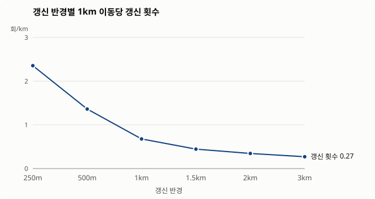
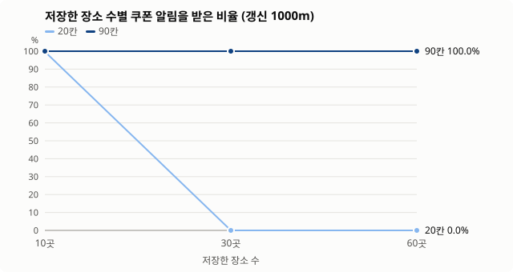

## 갱신 반경: 왜 1km인가

`./gradlew :app:testDebugUnitTest -Psim -PsimWrite`로 다시 만들 수 있어요 (난수 시드 고정). 앞부분은 지점을 고르게 뿌린 통제 실험, 뒷부분은 [실제 서울 데이터로 확인](#실제-서울-데이터로-확인)이에요.

### 무엇을 정하는 값인가

휴대폰은 한 번에 정해진 수(앱은 90칸)만 지오펜스로 감시할 수 있어요. 그래서 앱은 **지금 자리에서 가까운 지점을 브랜드마다 7곳씩** 골라 등록하고, 사용자가 그 자리에서 **갱신 반경**만큼 멀어지면 새 자리 기준으로 다시 골라요.

- 반경이 작으면: 등록된 지점이 늘 지금 위치 근처라 놓치지 않지만, 자주 위치를 다시 받고 카카오를 다시 검색해요 (배터리, API 호출).
- 반경이 크면: 갱신은 드물지만, 멀어진 뒤에는 "아까 자리 근처" 지점만 등록돼 있어서 지금 지나가는 지점을 놓쳐요.

이 실험은 그 사이 어디가 적당한지를, 지점 배치를 단순하게 통제해서 봐요.

### 실험 설정

- **지점**: 한 브랜드 지점 50곳을 원 안에 고르게 뿌려요 (위도·경도만, 쿠폰이나 카카오 검색 없음). 원 반경을 바꿔 밀도를 세 가지로 봐요.

  | 원 반경 | km²당 지점 | 서울에서 비슷한 경우 |
  |---|---|---|
  | 1km | 15.9곳 | 번화가 한가운데 (강남역·홍대 앞) |
  | 3km | 1.8곳 | 메가커피 서울 평균 (1282곳 ÷ 605km² ≈ 2.1곳) |
  | 5km | 0.6곳 | 올리브영 서울 평균 (434곳 ÷ 605km² ≈ 0.7곳) |

- **사람**: 원 안 아무 곳에서 출발해 최대 1.2km씩 5번 걸어요 (1.4m/s). 500명 × 시드 3개
- **등록 규칙**: 앱의 `planRegions`를 그대로 써요 (90칸, 브랜드당 가까운 7곳)
- **갱신 지연**: 갱신 반경을 벗어난 뒤 새 목록이 등록되기까지 2분 (아래 표에 0초도 있어요)
- **지점 근처를 지났다**: 지점 200m 안에 들어갔다 나온 한 번. 그동안 한 순간이라도 그 지점이 등록돼 있으면 알림이 울려요

### 지표

- **처음 지나간 지점에서 알림** (주 지표): 산책 중 처음 지나간 지점에서 바로 알림이 울린 비율. 쿠폰은 브랜드마다 한 번 울리면 되지만, 처음 지점을 놓치면 다음 지점까지 늦어져요
- **알림이 한 번이라도**: 산책 중 어느 지점에서든 한 번 울린 비율
- **지나간 지점을 감시 중이던 비율**: 지나간 모든 지점 중 그 순간 등록돼 있던 비율. 가장 엄격하지만 사용자가 받는 알림과는 달라요 (아래 "주의" 참고)
- 괄호는 (해당 수 / 전체 수)예요. 지점을 하나라도 지난 산책만 셌어요

### 결과

첫 그래프는 "처음 지나간 지점에서 알림"의 반대, 즉 **처음 지점을 놓친 비율**이에요 (100% − 알림 비율). 세로축은 0%부터 시작해요. 1km까지는 바닥에 붙어 있다가, 1km를 넘으면 지점 밀도가 평균인 곳에서 놓치는 비율이 빠르게 올라가요.

### 해석: 왜 1km인가

**서울 평균 밀도(원 반경 3km, km²당 1.8곳, 지연 2분)를 기준으로:**

| 갱신 반경 | 처음 지나간 지점에서 알림 | km당 갱신 |
|---|---|---|
| 250m | 100.0% | 2.35 |
| 500m | 100.0% | 1.36 |
| **1km** | 99.1% | 0.68 |
| 1.5km | 94.3% | 0.44 |
| 2km | 89.7% | 0.35 |
| 3km | 87.1% | 0.27 |

1. **1km까지는 알림을 거의 잃지 않아요.** 처음 지나간 지점에서 울리는 비율이 250m 100.0%, 500m 100.0%, 1km 99.1%예요.
2. **1km를 넘으면 눈에 띄게 떨어져요.** 1.5km 94.3%, 2km 89.7%예요. 열 번 중 한 번꼴로 첫 지점을 놓치는 셈이에요.
3. **갱신은 1km에서 이미 크게 줄어요.** 500m보다 2.0배, 250m보다 3.5배 적게 갱신해요. km당 갱신이 250m→500m에서 0.99회, 500m→1km에서 0.68회 줄고, 1km→2km는 0.33회 줄어요. 반경을 키울수록 아끼는 양은 작아지는데, 1km를 넘으면 알림은 눈에 띄게 잃어요.
4. **그래서 1km가 꺾이는 지점이에요.** 알림 손실 없이 갱신을 가장 많이 줄일 수 있는 값이에요.

**밀도가 달라도 1km는 안전해요.**

- **번화가 (km²당 15.9곳)**: 1km에서도 처음 지점 알림 98.7%예요. 근처에 지점이 많아 등록된 7곳 중 하나는 거의 늘 지나가요.
- **드문 곳 (km²당 0.6곳)**: 1km 99.9%, 2km 98.0%, 3km 94.3%예요. 지점이 드물면 더 키워도 버티지만, 1km에서도 손해는 없어요.
- 실제 앱은 사용자 주변 밀도를 미리 알 수 없어요. **어느 밀도에서도 알림을 잃지 않는 가장 큰 값**으로 1km를 골랐어요.

### 주의

- **"지나간 지점을 감시 중이던 비율"은 번화가에서 낮게 나와요** (1km에서 44.2%). 지점은 많은데 브랜드당 7곳만 등록하니까요. 그래도 그중 하나는 거의 늘 지나가서, 사용자가 받는 알림(98.7%)에는 영향이 없어요. 이 지표만 보면 결론을 잘못 읽어요.
- **갱신 지연이 결과를 바꿔요.** 2분은 가정값이에요. 실제 기기에서 갱신에 걸리는 시간을 재서 다시 확인해야 해요.
- **걷기만 봤어요.** 버스로 지나가는 알림은 앱이 일부러 미루기 때문에 여기서는 빼요. 실제 서울 데이터와 버스를 섞은 결과는 아래 [실제 서울 데이터로 확인](#실제-서울-데이터로-확인)에 있어요.
- **브랜드 하나만 넣었어요.** 브랜드가 여러 개여도 칸(90칸)이 넉넉하면 브랜드마다 같은 규칙이 따로 적용돼서 결과는 같아요.

### 전체 표

#### 원 반경 3km (km²당 1.8곳, 서울 평균)

| 갱신 반경 | 갱신 지연 | 처음 지나간 지점에서 알림 | 알림이 한 번이라도 | 지나간 지점을 감시 중이던 비율 | km당 갱신 |
|---|---|---|---|---|---|
| 250m | 2분 | 100.0% (1384/1384) | 100.0% (1384/1384) | 100.0% (4323/4323) | 2.35 |
| 500m | 2분 | 100.0% (1384/1384) | 100.0% (1384/1384) | 99.9% (4319/4323) | 1.36 |
| **1km (지금 설정)** | 2분 | 99.1% (1372/1384) | 99.9% (1382/1384) | 97.0% (4194/4323) | 0.68 |
| 1.5km | 2분 | 94.3% (1305/1384) | 97.5% (1349/1384) | 86.6% (3745/4323) | 0.44 |
| 2km | 2분 | 89.7% (1242/1384) | 93.7% (1297/1384) | 76.0% (3284/4323) | 0.35 |
| 3km | 2분 | 87.1% (1205/1384) | 89.2% (1234/1384) | 67.1% (2901/4323) | 0.27 |
| 250m | 0초 | 100.0% (1384/1384) | 100.0% (1384/1384) | 100.0% (4323/4323) | 3.51 |
| 500m | 0초 | 100.0% (1384/1384) | 100.0% (1384/1384) | 100.0% (4322/4323) | 1.67 |
| 1km | 0초 | 99.7% (1380/1384) | 99.9% (1383/1384) | 98.3% (4249/4323) | 0.73 |
| 1.5km | 0초 | 95.9% (1327/1384) | 97.9% (1355/1384) | 88.8% (3839/4323) | 0.47 |
| 2km | 0초 | 90.5% (1252/1384) | 94.2% (1304/1384) | 77.2% (3337/4323) | 0.35 |
| 3km | 0초 | 87.1% (1206/1384) | 89.3% (1236/1384) | 67.5% (2920/4323) | 0.27 |

#### 원 반경 1km (km²당 15.9곳, 번화가)

| 갱신 반경 | 갱신 지연 | 처음 지나간 지점에서 알림 | 알림이 한 번이라도 | 지나간 지점을 감시 중이던 비율 | km당 갱신 |
|---|---|---|---|---|---|
| 250m | 2분 | 100.0% (1500/1500) | 100.0% (1500/1500) | 95.2% (31198/32779) | 2.30 |
| 500m | 2분 | 99.3% (1489/1500) | 100.0% (1500/1500) | 77.1% (25281/32779) | 1.28 |
| **1km (지금 설정)** | 2분 | 98.7% (1481/1500) | 100.0% (1500/1500) | 44.2% (14474/32779) | 0.57 |
| 1.5km | 2분 | 98.7% (1481/1500) | 99.7% (1495/1500) | 30.7% (10071/32779) | 0.34 |
| 2km | 2분 | 98.7% (1481/1500) | 99.6% (1494/1500) | 27.6% (9035/32779) | 0.29 |
| 3km | 2분 | 98.7% (1481/1500) | 99.6% (1494/1500) | 27.6% (9035/32779) | 0.29 |
| 250m | 0초 | 100.0% (1500/1500) | 100.0% (1500/1500) | 98.9% (32410/32779) | 3.38 |
| 500m | 0초 | 99.7% (1496/1500) | 100.0% (1500/1500) | 86.2% (28258/32779) | 1.53 |
| 1km | 0초 | 98.8% (1482/1500) | 100.0% (1500/1500) | 47.4% (15536/32779) | 0.60 |
| 1.5km | 0초 | 98.7% (1481/1500) | 99.7% (1495/1500) | 31.6% (10358/32779) | 0.35 |
| 2km | 0초 | 98.7% (1481/1500) | 99.6% (1494/1500) | 27.6% (9035/32779) | 0.29 |
| 3km | 0초 | 98.7% (1481/1500) | 99.6% (1494/1500) | 27.6% (9035/32779) | 0.29 |

#### 원 반경 5km (km²당 0.6곳, 드문 곳)

| 갱신 반경 | 갱신 지연 | 처음 지나간 지점에서 알림 | 알림이 한 번이라도 | 지나간 지점을 감시 중이던 비율 | km당 갱신 |
|---|---|---|---|---|---|
| 250m | 2분 | 100.0% (927/927) | 100.0% (927/927) | 100.0% (1552/1552) | 2.36 |
| 500m | 2분 | 100.0% (927/927) | 100.0% (927/927) | 100.0% (1552/1552) | 1.36 |
| **1km (지금 설정)** | 2분 | 99.9% (926/927) | 100.0% (927/927) | 99.8% (1549/1552) | 0.69 |
| 1.5km | 2분 | 99.5% (922/927) | 100.0% (927/927) | 99.0% (1537/1552) | 0.44 |
| 2km | 2분 | 98.0% (908/927) | 98.4% (912/927) | 96.7% (1501/1552) | 0.35 |
| 3km | 2분 | 94.3% (874/927) | 95.1% (882/927) | 90.7% (1407/1552) | 0.27 |
| 250m | 0초 | 100.0% (927/927) | 100.0% (927/927) | 100.0% (1552/1552) | 3.51 |
| 500m | 0초 | 100.0% (927/927) | 100.0% (927/927) | 100.0% (1552/1552) | 1.67 |
| 1km | 0초 | 100.0% (927/927) | 100.0% (927/927) | 100.0% (1552/1552) | 0.74 |
| 1.5km | 0초 | 99.6% (923/927) | 100.0% (927/927) | 99.2% (1540/1552) | 0.46 |
| 2km | 0초 | 98.4% (912/927) | 98.8% (916/927) | 97.2% (1508/1552) | 0.35 |
| 3km | 0초 | 94.5% (876/927) | 95.4% (884/927) | 90.9% (1411/1552) | 0.27 |

## 실제 서울 데이터로 확인

위 통제 실험은 지점을 고르게 뿌리고 걷기만 봤어요. 여기서는 같은 계획 코드(`planRegions`)를 실제 서울 장소·지점과 버스 이동으로 돌려서, 1km 설정이 실제 환경에서도 알림을 잃지 않는지 확인해요.

### 가정

- **실제 서울 데이터** (카카오 로컬 API, 2026-10-13, `app/src/test/resources/sim/seoul.json`)
  - 저장할 만한 장소 160곳: 성수, 연남·홍대, 한남·이태원, 을지로, 잠실, 강남역, 여의도, 서촌·삼청 8개 동네의 카페·음식점·전시/공연장 (동네마다 20곳)
  - 쿠폰 지점: 스타벅스 755곳, 메가커피 1282곳, 올리브영 434곳
- **사용자 40명 × 하루 5번 외출**, 시드 3개로 반복 (총 600번 외출, 시드당 약 4609km)
  - 집은 동네들을 둘러싼 지역의 아무 곳. 외출은 한 동네에 가서 네 곳을 걸어 다니고, 40%는 다른 동네에 한 번 더 들렀다가 집으로
  - 1.5km보다 먼 구간은 버스(6.0m/s), 나머지는 걷기(1.4m/s)
  - 사용자는 세 브랜드 쿠폰을 모두 가지고 있다고 봐요. 저장한 장소는 사람마다 160곳 중 무작위로, 기본 30곳이고 10곳은 30곳에, 30곳은 60곳에 포함돼요
- **방문**: 장소·지점 반경(200m) 안에 들어갔다 나온 한 번. 그 사이 한 순간이라도 그곳이 OS 감시 목록에 들어 있으면 "잡은 방문"이에요
- **쿠폰 알림** (사용자가 받는 것): 어떤 브랜드 지점을 하나라도 지나간 외출에서, 그 브랜드 알림이 한 번이라도 울린 비율이에요
- **지나간 지점을 감시 중이던 비율** (더 엄격한 지표): 지점 200m 안을 지나간 모든 경우 중, 그 순간 바로 그 지점이 감시 목록에 있던 비율이에요
- **버스로 지나가며 울린 알림**: 지금 앱은 이 알림을 미뤘다가, 근처에서 내려 걸을 때만 울려요
- 카카오 검색은 실제처럼 격자 칸 중심에서 반경 2.5km, 최대 45곳만 돌려준다고 가정. 갱신 지연은 따로 적지 않으면 2분
- 수치는 시드 3개의 평균이고, 괄호는 (최솟값–최댓값)과 (해당 수/전체 수)예요

### 갱신 반경

| 갱신 반경 (90칸) | 쿠폰 알림 | 지나간 지점을 감시 중이던 비율 | km당 갱신 횟수 |
|---|---|---|---|
| 500m | 100.0% | 80.5% | 0.84 |
| **1000m (지금 설정)** | 100.0% | 64.0% | 0.56 |
| 2000m | 99.9% | 44.1% | 0.34 |

- **사용자가 받는 쿠폰 알림은 500m와 1km가 같아요** (100.0%). 500m는 갱신을 1.5배 더 하지만 사용자에게 달라지는 건 거의 없어요. 통제 실험과 같은 결론이에요.
- **"지나간 지점을 감시 중이던 비율"은 반경이 커질수록 떨어져요** (500m 80.5%, 1km 64.0%, 2km 44.1%). 서울 데이터는 번화가에 지점이 몰려 있어서, 브랜드당 7곳만 등록하면 지나가는 지점 중 상당수는 목록 밖이에요. 그래도 그중 하나는 거의 늘 지나가서 알림은 울려요.
- **칸 수는 큰 원인이 아니에요.** 50칸과 90칸의 차이는 2%p 안팎이에요.
- **갱신 지연이 크게 작용해요.** 같은 1km라도 지연 0초면 80.6%, 2분이면 64.0%, 5분이면 48.2%예요. 2분은 가정값이라 실제 기기에서 재야 해요.

#### 전략별 전체 표

| 전략 | 저장한 장소 | 쿠폰 알림 (지점을 지난 이동 중) | 지나간 지점을 감시 중이던 비율 | km당 갱신 횟수 | 버스로 지나가며 울린 알림 |
|---|---|---|---|---|---|
| 고정 (출발 때 한 번, 90칸) | 100.0% (3103/3103) | 56.2% (54.9–58.4) (1007/1793) | 7.3% (6.4–7.9) (2984/40706) | 0.04 | 57.1% |
| 움직이는 창 20칸 · 갱신 500m | 100.0% (3103/3103) | 0.0% (0/1793) | 0.0% (0/40706) | 0.84 | 44.1% |
| 움직이는 창 20칸 · 갱신 1000m | 100.0% (3103/3103) | 0.0% (0/1793) | 0.0% (0/40706) | 0.56 | 44.1% |
| 움직이는 창 20칸 · 갱신 2000m | 100.0% (3103/3103) | 0.0% (0/1793) | 0.0% (0/40706) | 0.34 | 44.1% |
| 움직이는 창 50칸 · 갱신 500m | 100.0% (3103/3103) | 100.0% (1793/1793) | 78.5% (77.8–79.1) (31935/40706) | 0.84 | 62.8% |
| 움직이는 창 50칸 · 갱신 1000m | 100.0% (3103/3103) | 100.0% (1793/1793) | 61.4% (60.5–62.3) (25007/40706) | 0.56 | 62.5% |
| 움직이는 창 50칸 · 갱신 2000m | 100.0% (3103/3103) | 99.8% (99.7–100.0) (1789/1793) | 42.0% (41.3–43.0) (17081/40706) | 0.34 | 61.1% |
| 움직이는 창 90칸 · 갱신 500m | 100.0% (3103/3103) | 100.0% (1793/1793) | 80.5% (79.9–81.0) (32772/40706) | 0.84 | 62.8% |
| 움직이는 창 90칸 · 갱신 1000m | 100.0% (3103/3103) | 100.0% (1793/1793) | 64.0% (63.2–64.7) (26046/40706) | 0.56 | 62.6% |
| 움직이는 창 90칸 · 갱신 2000m | 100.0% (3103/3103) | 99.9% (99.8–100.0) (1791/1793) | 44.1% (43.5–45.1) (17946/40706) | 0.34 | 61.3% |
| 움직이는 창 90칸 · 갱신 1000m · 갱신 지연 0초 | 100.0% (3103/3103) | 100.0% (1793/1793) | 80.6% (79.3–82.1) (32791/40706) | 0.86 | 62.8% |
| 움직이는 창 90칸 · 갱신 1000m · 갱신 지연 5분 | 100.0% (3103/3103) | 99.9% (99.8–100.0) (1791/1793) | 48.2% (47.5–49.4) (19638/40706) | 0.36 | 61.2% |

저장한 장소는 모든 설정에서 놓친 방문이 없어요. 장소가 우선순위 1순위라 가까운 순으로 먼저 칸을 차지해서, 근처에 가면 늘 등록돼 있어요. 설정에 따라 달라지는 건 쿠폰 쪽이에요.

### 저장한 장소 수 (갱신 1000m)

칸이 적은 iOS 한도(20칸)에서 저장한 장소가 늘면, 장소가 칸을 모두 차지해서 쿠폰 지점이 한 곳도 등록되지 못해요. Android(90칸)에서는 60곳을 저장해도 쿠폰 알림이 그대로예요. iOS로 넓힐 때는 쿠폰 몫으로 칸을 몇 개 남겨 두는 규칙이 필요해요.

| 전략 | 저장한 장소 | 쿠폰 알림 (지점을 지난 이동 중) | 지나간 지점을 감시 중이던 비율 | km당 갱신 횟수 | 버스로 지나가며 울린 알림 |
|---|---|---|---|---|---|
| 20칸 · 저장한 장소 10곳 | 100.0% (1033/1033) | 99.7% (99.7–99.8) (1788/1793) | 42.2% (41.8–43.1) (17180/40706) | 0.56 | 75.4% |
| 20칸 · 저장한 장소 30곳 | 100.0% (3103/3103) | 0.0% (0/1793) | 0.0% (0/40706) | 0.56 | 44.1% |
| 20칸 · 저장한 장소 60곳 | 100.0% (6366/6366) | 0.0% (0/1793) | 0.0% (0/40706) | 0.56 | 44.5% |
| 90칸 · 저장한 장소 10곳 | 100.0% (1033/1033) | 100.0% (1793/1793) | 64.0% (63.2–64.7) (26046/40706) | 0.56 | 76.5% |
| 90칸 · 저장한 장소 30곳 | 100.0% (3103/3103) | 100.0% (1793/1793) | 64.0% (63.2–64.7) (26046/40706) | 0.56 | 62.6% |
| 90칸 · 저장한 장소 60곳 | 100.0% (6366/6366) | 100.0% (1793/1793) | 64.0% (63.2–64.7) (26046/40706) | 0.56 | 55.6% |

### 브랜드당 지점 수 (90칸 · 갱신 1000m · 지연 2분)

쿠폰은 "어느 지점이든 한 번 알려 주면 되는" 성격이라 지점 하나하나를 다 잡을 필요는 없어요. 브랜드마다 가까운 몇 곳만 등록하면 남는 칸이 저장한 장소와 다른 브랜드에 돌아가요.

| 전략 | 저장한 장소 | 쿠폰 알림 (지점을 지난 이동 중) | 지나간 지점을 감시 중이던 비율 | km당 갱신 횟수 | 버스로 지나가며 울린 알림 |
|---|---|---|---|---|---|
| 브랜드당 3곳 | 100.0% (3103/3103) | 99.7% (99.7–99.8) (1788/1793) | 42.2% (41.8–43.1) (17180/40706) | 0.56 | 62.0% |
| **브랜드당 7곳 (지금 설정)** | 100.0% (3103/3103) | 100.0% (1793/1793) | 64.0% (63.2–64.7) (26046/40706) | 0.56 | 62.6% |
| 제한 없음 | 100.0% (3103/3103) | 100.0% (1793/1793) | 90.9% (90.5–91.1) (36992/40706) | 0.56 | 62.8% |
