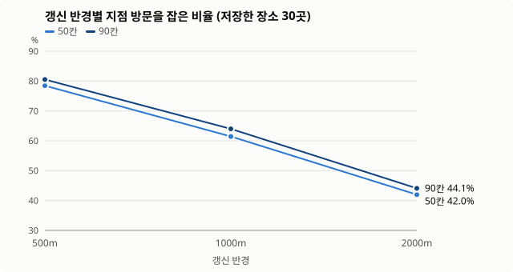
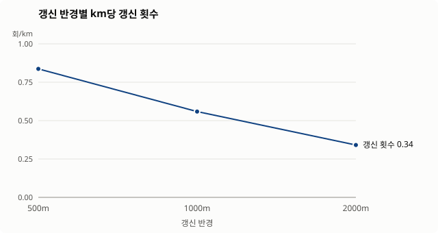

## 지오펜스 전략 시뮬레이션

`./gradlew :app:testDebugUnitTest -Psim -PsimWrite`로 다시 만들 수 있어요 (난수 시드 고정).

### 가정

- **실제 서울 데이터** (카카오 로컬 API, 2026-10-13, `app/src/test/resources/sim/seoul.json`)
  - 저장할 만한 장소 160곳: 성수, 연남·홍대, 한남·이태원, 을지로, 잠실, 강남역, 여의도, 서촌·삼청 8개 동네의 카페·음식점·전시/공연장 (동네마다 20곳)
  - 쿠폰 지점: 스타벅스 755곳, 메가커피 1282곳, 올리브영 434곳
- **사용자 40명 × 하루 5번 외출**, 시드 3개로 반복 (총 600번 외출, 시드당 약 4609km)
  - 집은 동네들을 둘러싼 지역의 아무 곳. 외출은 한 동네에 가서 네 곳을 걸어 다니고, 40%는 다른 동네에 한 번 더 들렀다가 집으로
  - 1.5km보다 먼 구간은 버스(6.0m/s), 나머지는 걷기(1.4m/s)
  - 저장한 장소는 사람마다 160곳 중 무작위. 기본 30곳이고, 10곳은 30곳에, 30곳은 60곳에 포함돼요
- **방문**: 장소·지점 반경(200m) 안에 들어간 구간. 그 구간 중 한 순간이라도 그곳이 OS에 등록돼 있으면 "잡은 방문"
- **쿠폰 알림**: 어떤 브랜드 지점을 하나라도 지나간 외출에서, 그 브랜드 알림이 한 번이라도 울린 비율. **지점 방문 전체**: 지점 하나하나의 방문을 다 잡은 비율
- **버스로 지나가며 울린 알림**: 지금 앱은 이 알림을 미뤘다가, 근처에서 내려 걸을 때만 울려요
- 카카오 검색은 실제처럼 격자 칸 중심에서 반경 2.5km, 최대 45곳만 돌려준다고 가정. 깨어나 다시 고르기까지 별도 표시가 없으면 2분
- 수치는 시드 3개의 평균이고, 괄호는 최솟값–최댓값이에요 (차이가 거의 없으면 생략)

### 갱신 반경과 칸 수

| 전략 | 저장한 장소 | 쿠폰 알림 (지점을 지난 이동 중) | 지점 방문 전체 | 다시 고른 횟수 / km | 버스로 지나가며 울린 알림 |
|---|---|---|---|---|---|
| 고정 (출발 때 한 번, 90칸) | 100.0% (3103/3103) | 56.2% (54.9–58.4) | 7.3% (6.4–7.9) | 0.04 | 57.1% |
| 움직이는 창 20칸 · 갱신 500m | 100.0% (3103/3103) | 0.0% | 0.0% | 0.84 | 44.1% |
| 움직이는 창 20칸 · 갱신 1000m | 100.0% (3103/3103) | 0.0% | 0.0% | 0.56 | 44.1% |
| 움직이는 창 20칸 · 갱신 2000m | 100.0% (3103/3103) | 0.0% | 0.0% | 0.34 | 44.1% |
| 움직이는 창 50칸 · 갱신 500m | 100.0% (3103/3103) | 100.0% | 78.5% (77.8–79.1) | 0.84 | 62.8% |
| 움직이는 창 50칸 · 갱신 1000m | 100.0% (3103/3103) | 100.0% | 61.4% (60.5–62.3) | 0.56 | 62.5% |
| 움직이는 창 50칸 · 갱신 2000m | 100.0% (3103/3103) | 99.8% (99.7–100.0) | 42.0% (41.3–43.0) | 0.34 | 61.1% |
| 움직이는 창 90칸 · 갱신 500m | 100.0% (3103/3103) | 100.0% | 80.5% (79.9–81.0) | 0.84 | 62.8% |
| 움직이는 창 90칸 · 갱신 1000m | 100.0% (3103/3103) | 100.0% | 64.0% (63.2–64.7) | 0.56 | 62.6% |
| 움직이는 창 90칸 · 갱신 2000m | 100.0% (3103/3103) | 99.9% (99.8–100.0) | 44.1% (43.5–45.1) | 0.34 | 61.3% |
| 움직이는 창 90칸 · 갱신 1000m · 깨어남 지연 0초 | 100.0% (3103/3103) | 100.0% | 80.6% (79.3–82.1) | 0.86 | 62.8% |
| 움직이는 창 90칸 · 갱신 1000m · 깨어남 지연 5분 | 100.0% (3103/3103) | 99.9% (99.8–100.0) | 48.2% (47.5–49.4) | 0.36 | 61.2% |

저장한 장소는 모든 설정에서 놓친 방문이 없어요. 장소가 우선순위 1순위라 가까운 순으로 먼저 칸을 차지해서, 근처에 가면 늘 등록돼 있어요. 설정에 따라 달라지는 건 쿠폰 쪽이에요.

### 저장한 장소 수 (갱신 1000m)

칸이 적은 iOS 한도(20칸)에서 저장한 장소가 늘면, 장소가 칸을 모두 차지해서 쿠폰 지점이 한 곳도 등록되지 못해요. Android(90칸)에서는 60곳을 저장해도 쿠폰 알림이 그대로예요. iOS로 넓힐 때는 쿠폰 몫으로 칸을 몇 개 남겨 두는 규칙이 필요해요.

| 전략 | 저장한 장소 | 쿠폰 알림 (지점을 지난 이동 중) | 지점 방문 전체 | 다시 고른 횟수 / km | 버스로 지나가며 울린 알림 |
|---|---|---|---|---|---|
| 20칸 · 저장한 장소 10곳 | 100.0% (1033/1033) | 99.7% (99.7–99.8) | 42.2% (41.8–43.1) | 0.56 | 75.4% |
| 20칸 · 저장한 장소 30곳 | 100.0% (3103/3103) | 0.0% | 0.0% | 0.56 | 44.1% |
| 20칸 · 저장한 장소 60곳 | 100.0% (6366/6366) | 0.0% | 0.0% | 0.56 | 44.5% |
| 90칸 · 저장한 장소 10곳 | 100.0% (1033/1033) | 100.0% | 64.0% (63.2–64.7) | 0.56 | 76.5% |
| 90칸 · 저장한 장소 30곳 | 100.0% (3103/3103) | 100.0% | 64.0% (63.2–64.7) | 0.56 | 62.6% |
| 90칸 · 저장한 장소 60곳 | 100.0% (6366/6366) | 100.0% | 64.0% (63.2–64.7) | 0.56 | 55.6% |

### 브랜드당 지점 수 (90칸 · 갱신 1000m · 지연 2분)

쿠폰은 "어느 지점이든 한 번 알려 주면 되는" 성격이라 지점 하나하나를 다 잡을 필요는 없어요. 브랜드마다 가까운 몇 곳만 등록하면 남는 칸이 저장한 장소와 다른 브랜드에 돌아가요.

| 전략 | 저장한 장소 | 쿠폰 알림 (지점을 지난 이동 중) | 지점 방문 전체 | 다시 고른 횟수 / km | 버스로 지나가며 울린 알림 |
|---|---|---|---|---|---|
| 브랜드당 3곳 | 100.0% (3103/3103) | 99.7% (99.7–99.8) | 42.2% (41.8–43.1) | 0.56 | 62.0% |
| **브랜드당 7곳 (지금 설정)** | 100.0% (3103/3103) | 100.0% | 64.0% (63.2–64.7) | 0.56 | 62.6% |
| 제한 없음 | 100.0% (3103/3103) | 100.0% | 90.9% (90.5–91.1) | 0.56 | 62.8% |
